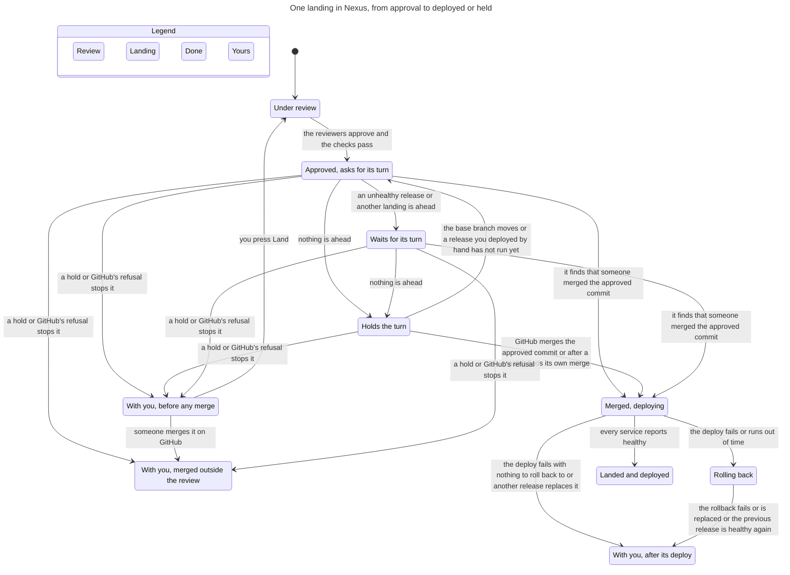

# One landing in Nexus

Drawn from `model/Chart.cfg` with the view `model/view.mjs`: one landing, one manual deploy, no pushes. The chart follows one landing. The person, GitHub and the fleet act in the background, and a step of theirs that leaves the landing where it is has no arrow.

Redraw it with the pstack `/statechart` skill after a change to the model.

