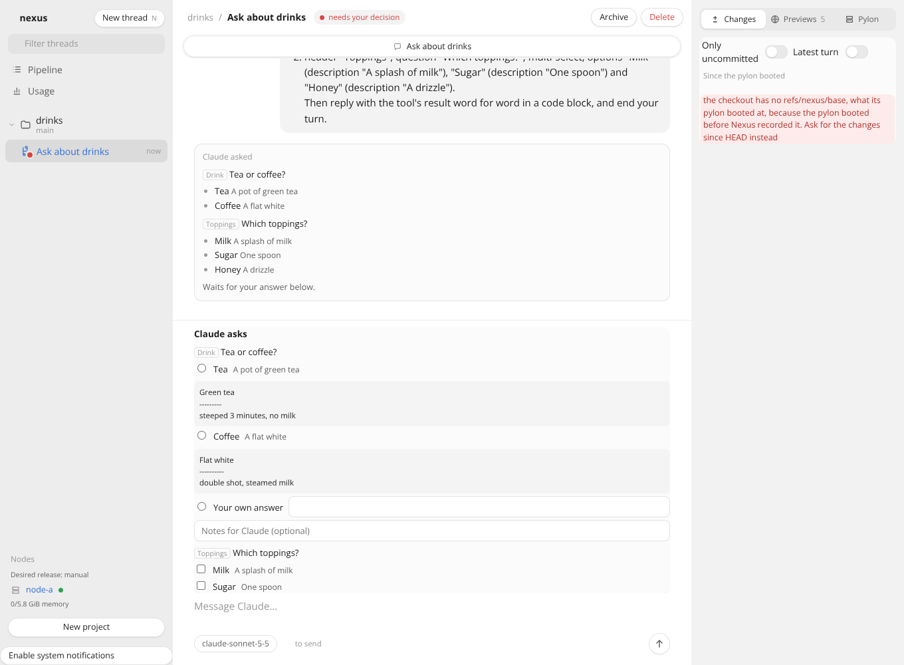
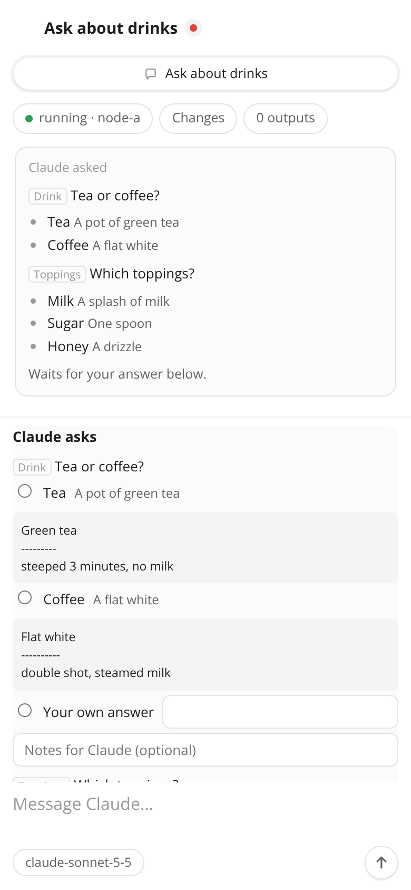
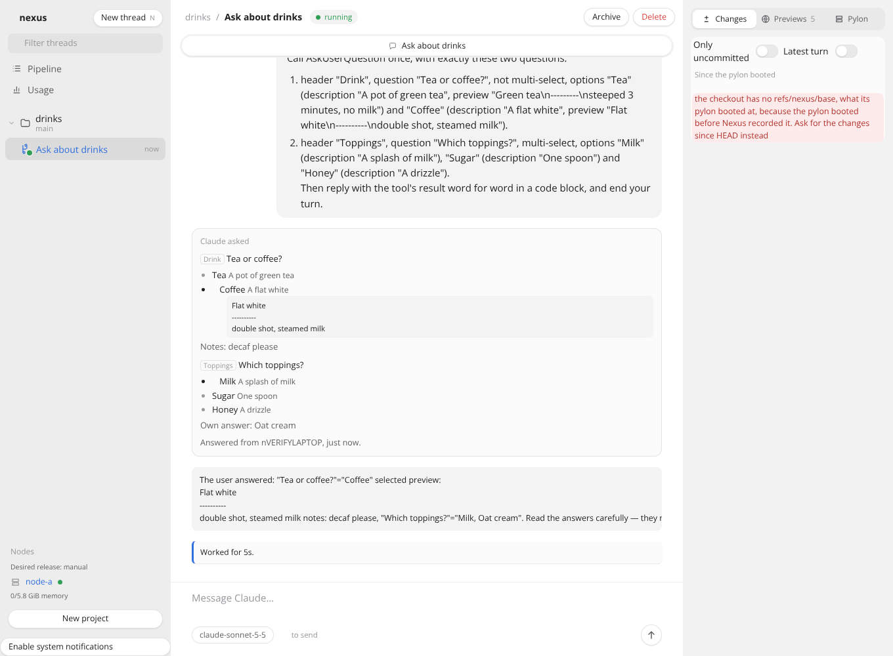
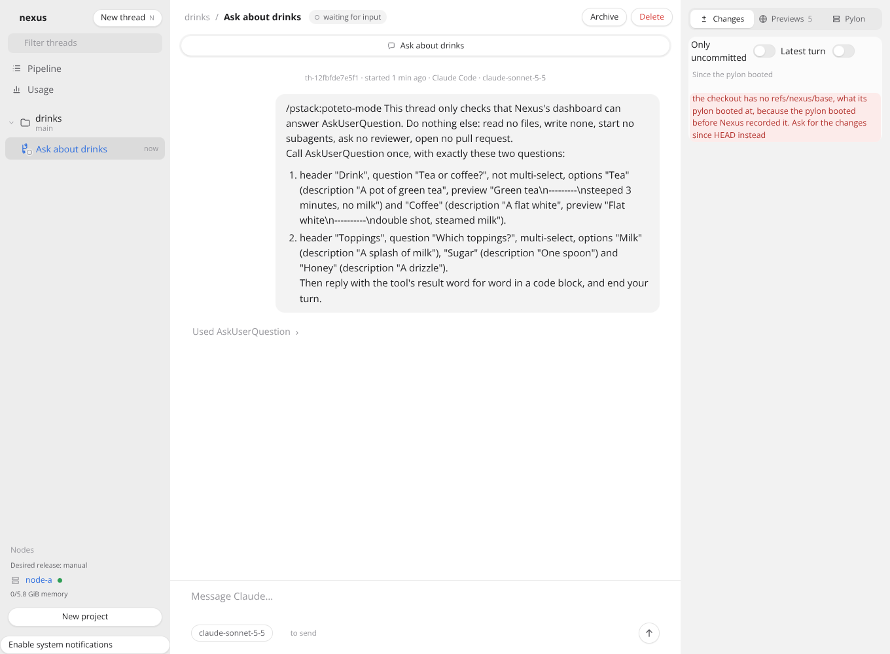

# Answering AskUserQuestion from the dashboard

Verified in this task's pylon on 2026-10-29, on branch `feat/ask-user-question-card` against main at db5eb92, with Claude Code 2.1.310, Herdr 0.9.5, Node 26.12.1 and headless Chromium from `@sparticuz/chromium` 138. No live control plane, node, image, GitHub repository or other thread was touched.

## How to rerun

```sh
MODULES=<node_modules with @sparticuz/chromium and puppeteer-core> LD_LIBRARY_PATH=<its al2023 lib> FONTCONFIG_PATH=<folder of a fonts.conf listing its fonts> \
  docs/verification/ask-user-question-card/run.sh origin/main HEAD
```

`run.sh` checks out main and the branch into two worktrees, copies `stack.ts` into each, builds the dashboard and runs `stack.ts drive` there. Each run's captures land in `main/` or `branch/`, with the commit in `commit.txt`. Both runs use the same file and the same steps, so the captures differ only by the code under test. `RUNS=main` or `RUNS=branch` runs one of them. It needs passwordless sudo and the Claude token placeholder in `/etc/profile.d/nexus-secrets.sh`, as a pylon has.

## The stack

Docker is not available in this pylon, so the verify-nexus stack could not run. `stack.ts` follows [the planning-cards stack](../planning-cards/README.md): the real `startControlPlane` of the checkout under test in one child process and its real probe server in another. Every command goes through the real `nexus` CLI, and every page through headless Chromium at 1360 by 1000 and at a phone's 390 by 844.

The Claude worker is a real Claude Code on Sonnet 5.5. The probe's VM backend boots nothing. Its one pylon is this machine, as the Linux user `verify`, whose HOME `/home/verify` stands in for `/home/user`. Each guest command runs as that user through sudo, with `/home/user` moved to `/home/verify` and the image's `nexus` scripts moved to copies of the checkout's `images/pylon`. So the Claude launch, Herdr, the transcript reads, the hooks and their settings, which `stack.ts` writes from the checkout's `claudeHooks` as `install.ts` does, are the checkout's own code. A pylon user's Claude reports only under its own HOME, which is why the worker needs a user of its own. The hooks post to the probe's real pylon API on 127.0.0.1:7489, which `verify`'s shells name as `NEXUS_API`, so no event reaches this pylon's own control plane. The stand-ins are tailscaled's whois, which answers the probe as the node and every other caller as the person's laptop `nVERIFYLAPTOP`, and the harness's scripted model, which a Claude worker thread never calls.

The driver:

1. Adds project `drinks` and starts a Claude worker whose prompt asks it to call AskUserQuestion with two questions. "Drink" is single-select, with options Tea and Coffee, each with a description and a preview. "Toppings" is multi-select, with Milk, Sugar and Honey.
2. Waits until the thread waits on the dialog, and then up to 30 s for a card. It captures `show`, the worker's terminal, the hook's files under `~/.nexus/asks` and the thread page at both widths.
3. With a card, fills it as the person does: Coffee with the note "decaf please", Milk, and "Oat cream" as an answer of their own, and presses Answer. Without one, presses Escape in the worker's terminal, the only place the dialog can be answered.
4. Waits for Claude's reply and captures the conversation, `show`, the terminal and the page.
5. On the branch, sends a second message asking one more question, waits for its card, answers it in the terminal with Enter, and waits for the card to go.

## The spike

`spike/` holds the hook logs that chose the delivery, from an isolated HOME whose hooks ran `spike/hook.cjs`.

- `pretooluse-answers.jsonl`. A PreToolUse hook that waits and then returns `permissionDecision: "allow"` with `updatedInput` holding `answers` and `annotations` answers the call, and Claude got every answer, the preview and the note. While it waits, though, Claude shows no dialog, so the terminal cannot answer. It was rejected for that.
- `permissionrequest-answers.jsonl`. A PermissionRequest hook runs while the dialog shows, in `bypassPermissions` mode too, which is how Nexus starts a worker. Returning `decision: {"behavior": "allow", "updatedInput": ...}` closed the dialog, and the terminal said "Allowed by PermissionRequest hook". This is the branch's delivery.
- `terminal-first.jsonl`. When the terminal answers first, the waiting hook keeps running, and an answer it prints afterwards changes nothing.

PermissionRequest's input names no tool call, so the branch's PreToolUse hook records the call's ID for it.

The first version of the branch opened a card from the transcript: a call with no result yet. That premise was wrong. Claude Code sometimes writes the call to the transcript only once the dialog is answered. In one run the call's record is stamped 00:33:38.661 but reached the file at about 00:33:58, with its result, while the Notification that made the thread `waiting` fired at about 00:33:47. Two of four asks got no card. The branch now opens a card from what the PermissionRequest hook reports waiting, and the transcript only closes one and shows it in the conversation.

## Main (`main/`) and this branch (`branch/`)

| Step | main, db5eb92 | this branch |
|---|---|---|
| Claude asks, `04-show-asked.txt` | attention `waiting`, no question | attention `decision`, and `question ask-toolu_…: Drink: Tea or coffee?`, `needs you` |
| The hook's files, `asks-asked.txt` | none | one `.waiting` record with the session, the call's ID and its input |
| The thread page, `01-asked-*.png` | "waiting for input", the prompt and no card | "needs your decision", the call in the conversation, and a form in the dock with both questions, their previews, an answer of one's own and notes |
| Answering | Escape in the terminal: "User declined to answer questions", and the thread stays `waiting`, since Claude runs no Stop hook for an interrupted turn | `02-filled-desktop.png`, then Answer. The page asks `Answer Claude "Drink: Coffee; Toppings: Milk, Oat cream"? The answer cannot be changed.`, and the card leaves the dock 1.0 s later |
| What Claude got, `terminal-answered.txt`, `06-conversation-answered.txt` | nothing | `"Tea or coffee?"="Coffee" selected preview: Flat white … notes: decaf please, "Which toppings?"="Milk, Oat cream"`, and "Allowed by PermissionRequest hook" |
| The answered card, `03-answered-*.png`, `07-show-answered.txt` | a failed tool step | the questions in the conversation with Coffee, its preview, the note, Milk and "Oat cream", "Answered from nVERIFYLAPTOP", and `answered "Drink: Coffee; Toppings: Milk, Oat cream" by nVERIFYLAPTOP` |
| A second ask answered in the terminal, `04-second-asked-*.png`, `05-second-answered-*.png` | not run | its card shows within 4 s, goes within 1.5 s of the terminal's Enter, and the conversation's card says "Answered in the terminal." |

`branch-repeats.txt` is the branch's run three times in a row. Each time both cards showed, the dashboard's answer reached Claude, and the terminal's answer withdrew its card.

Branch, the card at a desktop width:



Branch, the card at a phone width:



Branch, the answered card in the conversation:



Main, the same moment:



## Checks

`npm run typecheck` passes, and `npm test` passes 1554 of 1554 on the branch.

## Not verified

- A rebuilt pylon image, a real pylon and a real node. The hooks ran from the branch's files copied into `verify`'s HOME, and the probe's guest commands ran on this machine through sudo.
- A worker started on Opus, the default. The runs used Sonnet 5.5 for speed.
- A pylon that pauses while a dialog waits. Its card stays until the pylon wakes, and an answer then gets "Claude no longer waits", which the API tests cover.
- An old image's hook answering `answer` and `asks`. The API and question tests cover how the control plane reads each.
- Real fonts. The capture's Chromium has Open Sans only, so the ✓ on a picked option does not render in the screenshots. The picked option is still set in a heavier weight.
- Previews on the Previews tab. The 5 shown are this machine's own listening ports, which the stand-in guest reports.
