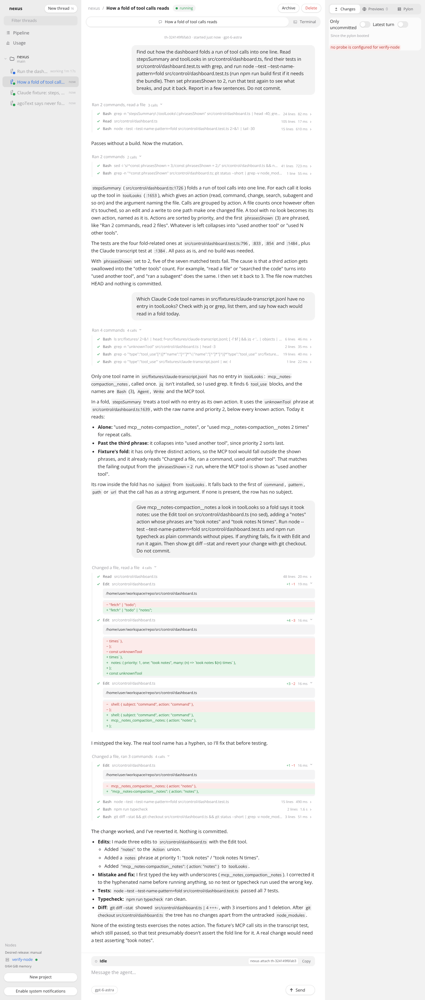
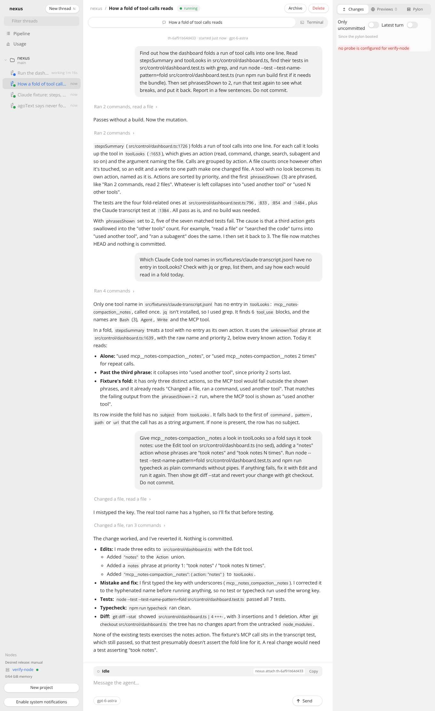
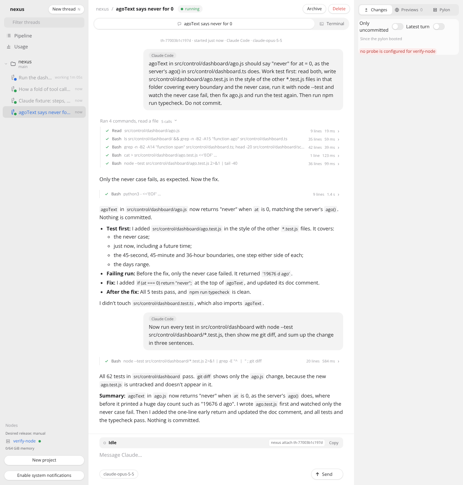
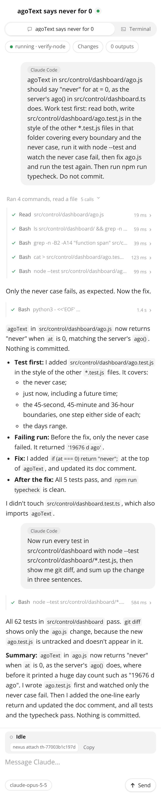
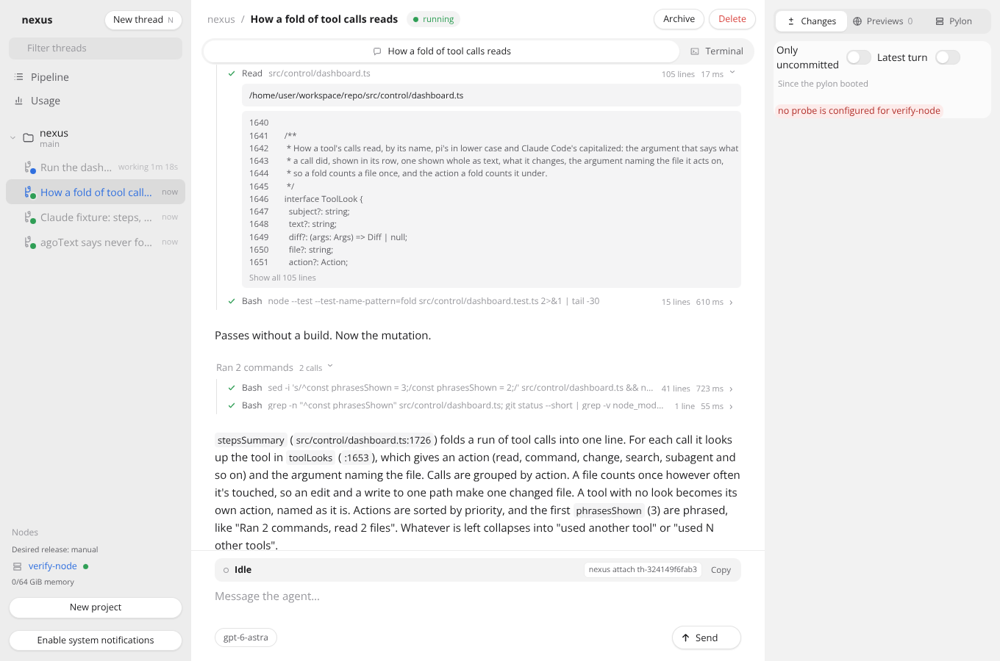
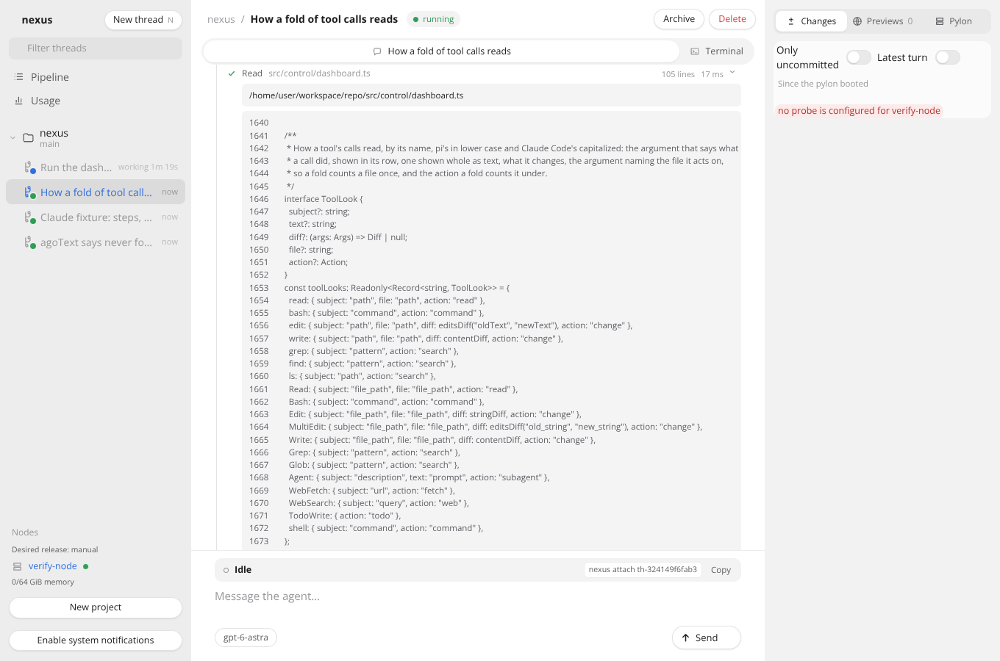

# The conversation view and its tool calls

Verified in this task's pylon on 2026-10-29, on branch `feat/conversation-view` against main at 1cebcf4, with Node 26.12.1 and headless Chromium from `@sparticuz/chromium` 138. No live control plane, node, image, GitHub repository or other thread was touched.

## How to rerun

```sh
MODULES=<node_modules with @sparticuz/chromium and puppeteer-core> LD_LIBRARY_PATH=<its al2023 lib> FONTCONFIG_PATH=<folder of a fonts.conf listing its fonts> \
  docs/verification/conversation-view/run.sh origin/main HEAD
```

`run.sh` checks out main and the branch into two worktrees, copies `stack.ts`, `drive.mjs` and `fixtures/` into each, builds the dashboard, starts `stack.ts` and runs `drive.mjs` against it. Each run's captures land in `main/` or `branch/`, with the commit in `commit.txt` and what the driver did in `drive.log`. Both runs use the same files and steps, so the captures differ only by the code under test. `RUNS=main` or `RUNS=branch` runs one of them.

`record.sh` made the two fixtures. It runs Claude Code on Sonnet in two worktrees of this repo and keeps the records the transcript parser reads, with the worktree's path written as the pylon's checkout, `/home/user/workspace/repo`. It needs a logged-in Claude Code, so the capture uses the committed fixtures rather than recording again.

## The stack

Docker is not available in this pylon, so the verify-nexus stack could not run. `stack.ts` follows [the dashboard polish stack](../dashboard-polish/README.md): the real registry, API and dashboard on `127.0.0.1:7470`, the test harness fake in place of pi-durable, and the node's observation written by the stack, so each pylon is a fake one that reports itself running. It seeds four threads:

- `worker`, a Claude worker whose transcript is `fixtures/claude-worker.jsonl`, a real two-turn Claude Code session that wrote a test, watched it fail, fixed `ago.js` and ran the client tests. The checkout's own `parseRecord` reads it.
- `fixture`, a Claude worker whose transcript is the repo's `src/fixtures/claude-transcript.jsonl`, with its failed calls, a subagent, steers and a compaction.
- `folds`, a harness thread whose conversation is `fixtures/harness-source.jsonl`, a real three-turn Claude Code session with Edit calls, its calls renamed to pi's tools (`bash`, `read`, `edit`) and each result given the `durationMs` pi-durable records, from the session's own timestamps.
- `running`, a harness thread whose `bash` call still runs, with the first 14 lines of a real test run as its output so far.

`drive.mjs` opens each thread at 1360 by 900 and at a phone's 390 by 844. It captures the whole conversation as one tall image (`-all`), then opens the first closed fold and the call with the longest output and captures that (`-opened`), then presses Show all where there is one (`-more`). It saves the conversation's text as `<thread>.txt`.

## Main (`main/`) and this branch (`branch/`)

| | main, 1cebcf4 | this branch |
|---|---|---|
| A run of calls | One closed line, such as "Ran 4 commands, read a file ›". No call shows until it is opened. | Each call is its own line under the group's line, which ends with "3 calls". Groups of up to five calls start open, so `folds` shows every call of its five groups. |
| A lone call | A closed "Ran a command ›" line | Its own line, with no group line. `worker`'s second turn and the running thread's calls show this. |
| A call's line | `› bash node --test … 15 lines ✓`, where the ✓ did not render in this Chromium | A check, cross, dash or spinner drawn as an icon, `Bash`, the key argument, `15 lines`, `610 ms` and a chevron |
| Tool names | `bash` in a harness thread, `Bash` in a Claude worker's | `Bash` in both, with `Read`, `Edit`, `Shell`, and the MCP notes tool as `notes` |
| Paths | `/home/user/workspace/repo/src/control/dashboard.ts` in a Claude worker's row | `src/control/dashboard.ts` in both, the full path in the opened body |
| Duration | none | `folds` reads `82 ms`, `17 ms`, `610 ms` for its first group, and `npm run typecheck` `1.6 s`. `fixture` reads `Write hello.py 109 ms` and `Bash false exit 1 24 ms`. |
| A long output | 105 lines in a box of 240 px that scrolls inside (`folds-desktop-opened.png`) | The first 12 lines and "Show all 105 lines" (`folds-desktop-opened.png`). Pressing it shows all 105 lines in place with no inner scroll (`folds-desktop-more.png`). Same for `worker`'s 42 lines. |
| The running call | Its output in a box that follows its end | Unchanged: its output is whole, in a box that follows its end, and the group says `1 running` |
| A phone | The row's line count is hidden and the ✓ took the end | One line each: mark, name, argument cut with an ellipsis, time and chevron. No page scrolls sideways at either width (`drive.log` reports none). |

The harness conversation, branch, desktop:



The same on main:



A Claude worker, branch, desktop and phone:





A long output clipped, then shown whole, branch:





## Checks

`npm run typecheck` passes, and `npm test` passes 1615 of 1615 on the branch.

## Not verified

- A real pylon, probe and harness turn. The conversations are seeded into the registry and the fake harness, so how a page looks is proven, not how pi-durable or a Claude transcript read reaches it. That a real harness result carries `durationMs` comes from pi-durable 1.4.0's `appendToolResult` and pi-ai's `ToolResultMessage` type, not from a run.
- The harness conversation is a Claude Code session with its calls renamed, not a session of pi's own tools, whose outputs differ in detail (pi's `read` has no line numbers).
- The dark theme. The new rules use only the theme's tokens, but no capture was taken in dark mode.
- A real phone, and fonts beyond the capture's Open Sans.
- A Claude worker's output past 8 KiB. The transcript parser already cuts each output at 8 KiB, so Show all shows what the parser kept, not the whole output.
