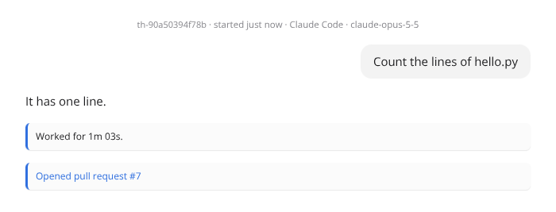
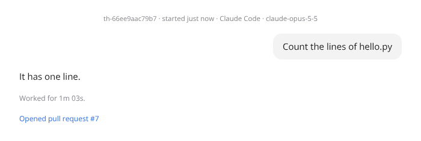

# Dashboard client verification

Run in this task's pylon on 2026-10-30, on branch `simplify/w6-dashboard-client` against main at 78d75d0, with Node
v26.12.1 and headless Chromium from `@sparticuz/chromium`. No live control plane, node, image or other thread was
touched.

## How to rerun

```sh
MODULES=<node_modules with @sparticuz/chromium and puppeteer-core> LD_LIBRARY_PATH=<its al2023 lib> FONTCONFIG_PATH=<its fonts.conf dir> \
  docs/verification/dashboard-client/run.sh origin/main <branch-commit>
```

`run.sh` checks out both commits into two worktrees, builds the dashboard in each and runs `drive.ts` there, so the
runs differ only by the code under test. Each run writes `result.json` and screenshots into `main/` or `branch/`.

`drive.ts` starts the real registry, API and dashboard with the fake model harness the API tests use, and no probe.

- **Rows over plain HTTP.** Headless Chromium counts `127.0.0.1` as a secure context, so the page removes
  `navigator.locks`, as a page over plain HTTP has none. One visible and one hidden home tab stay open for 30 s. The
  visible tab is then hidden and shown again.
- **Notes.** A Claude worker's transcript holds a reply, a turn's length and a pull request, which the server renders
  as `<p class="note">`. The script records each note's computed style and screenshots the conversation.
- **Terminal.** The attach WebSocket is a fake that says `attached` and then sends 200 lines of output, one each
  animation frame. `CSSStyleSheet.prototype.replaceSync` counts each copy of a style.
- **Changes pane.** The pane's text for an open thread whose pylon is not running, an archived thread and a deleted one.

## Results

| | main | branch |
| --- | --- | --- |
| List reads in 30 s, visible tab / hidden tab | 30 / 30 | 3 / 3 |
| Open `/v1/events` streams, visible tab / hidden tab | 0 / 0 | 1 / 0 |
| Visible tab's stream while hidden, then shown again | 0, 0 | 0, 1 |
| A note's colour, display, left border, padding | `--text`, grid, 3px, 8px 10px | `--text-3`, block, 0, 0 |
| Style copies as the terminal opens | 22 | 4 |
| Style copies for 200 frames of output | 1107 | 0 |

The changes pane reads the same on both but for an archived thread, whose text the branch shares with the diff.

Notes on main, which take the review card's rule:



Notes on the branch:



## Not covered

- The diff tab's text for a thread whose checkout cannot be read. `diff.test.js` pins it.
- A real browser's throttling of hidden tabs, and a page served from a tailnet name rather than `127.0.0.1`.
- The review card's look after the rename. The card's rule is unchanged but for its class.
