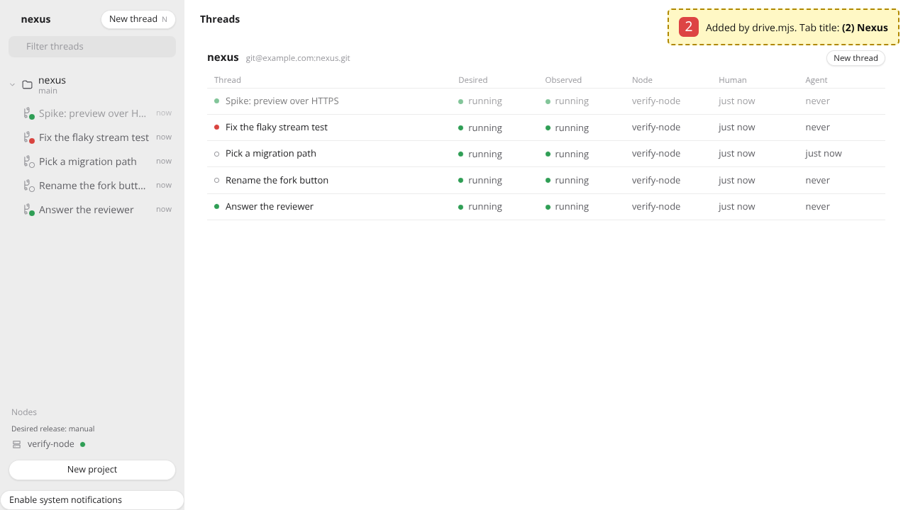
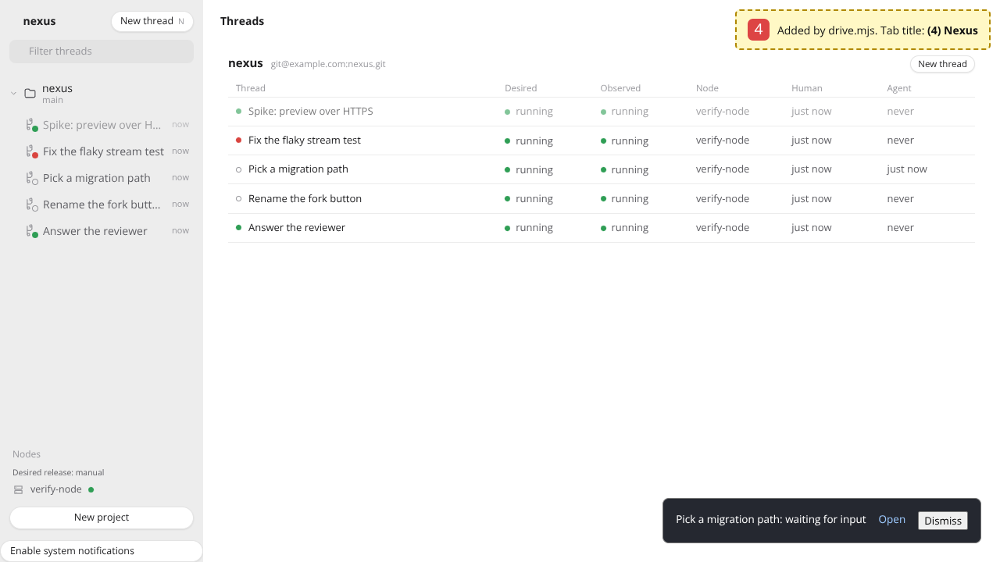

# One attention verification

Verified in this task's pylon on 2026-10-27, on branch `fix/issue-130-one-attention`, against main at 137242d, with
headless Chromium 153. No live control plane, node, image or other thread was touched.

## How to rerun

`run.sh` checks out main and the branch into two worktrees, copies `stack.ts` and `drive.mjs` into each, builds the
dashboard, starts the stack and drives it. Each run's captures land in `main/` or `branch/`, with the commit in
`commit.txt`. Both runs use the same two files, so the captures differ only by the code under test.

```sh
MODULES=<node_modules with @sparticuz/chromium and puppeteer-core> LD_LIBRARY_PATH=<its al2023/lib> \
  docs/verification/one-attention/run.sh origin/main HEAD
```

`stack.ts` runs the real registry, API and dashboard on 127.0.0.1:7470 with five threads: an unread reply, a Claude
session waiting for input, a Claude session working, a parked run and a seen idle thread. Docker is not available in
this pylon, so the verify-nexus stack could not run. As in `dashboard-polish`, the model harness is the test fake. The
stack tells the registry about the park the way the control plane's harness host does, and the session reports are
the registry calls the probe makes for a pylon's hooks. SIGUSR2 moves the working session to waiting, as Claude's
permission prompt does.

`drive.mjs` opens the home page, reads the rows, the tab title and the favicon, then sends SIGUSR2 and reads them
again three seconds later. The tab title and favicon are not part of a screenshot, so the driver adds a dashed yellow
box that shows them before each screenshot and removes it after. Then it drives the CLI: `events` for the parked
thread, `delete`, `show`, and `events` again.

## What was checked

A waiting session, by the row and by the badge and notifications.

| | main | branch |
|---|---|---|
| `01-home.png`, `drive.log` | "Rename the fork button" waits for input and its row is bright, but the tab title is `(2) Nexus`, counting only the reply and the parked run | `(3) Nexus`: the waiting thread counts too |
| `02-session-waits.png`, `drive.log` | "Pick a migration path" moves from working to waiting. Its row turns bright, the title stays `(2) Nexus` and no toast appears | The title is `(4) Nexus`, and a toast says "Pick a migration path: waiting for input" |

Main:



Branch:



Attention from the API against attention from the event stream, for a thread deleted while parked.

| | main | branch |
|---|---|---|
| `03-events-parked.txt` | `attention.changed {"attention":"parked"}` | the same |
| `05-show-deleted.txt` | `attention: none` | `attention: none` |
| `06-events-deleted.txt` | the last event is still `parked` | a new event says `null` |
| `drive.log`, last line | `THEY DISAGREE` | `they agree` |

`tests-main.txt` runs the two new behaviour tests at e994812, which adds them on top of main's code. Both fail: the
API says `null` where the event stream says `parked`, and a change to waiting notifies nothing. `tests-branch.txt`
runs them, and the registry test for threads whose attention was never stored, on the branch. All three pass.

## Not verified

- A real pylon, probe and pi-durable harness. Whether pi-durable's abort reports the run's end before the harness
  stops tracking a deleted thread was not checked. The fake harness does not report it, as `untrack` does not. With
  this branch a delete clears the parked flag either way.
- System notifications, which need HTTPS and a granted permission. They take their text from the same table as the
  toast, which was checked.
- An image whose Claude hook still reports the idle prompt as waiting (see the design's hooks section) will now also
  notify for it. That image predates the current matcher.
