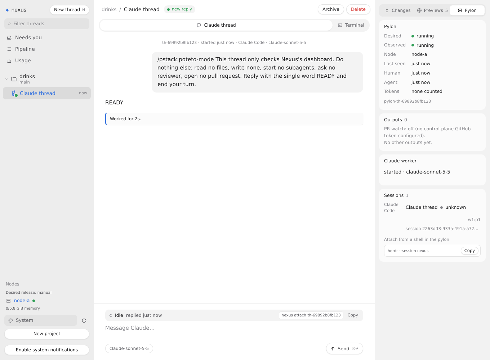
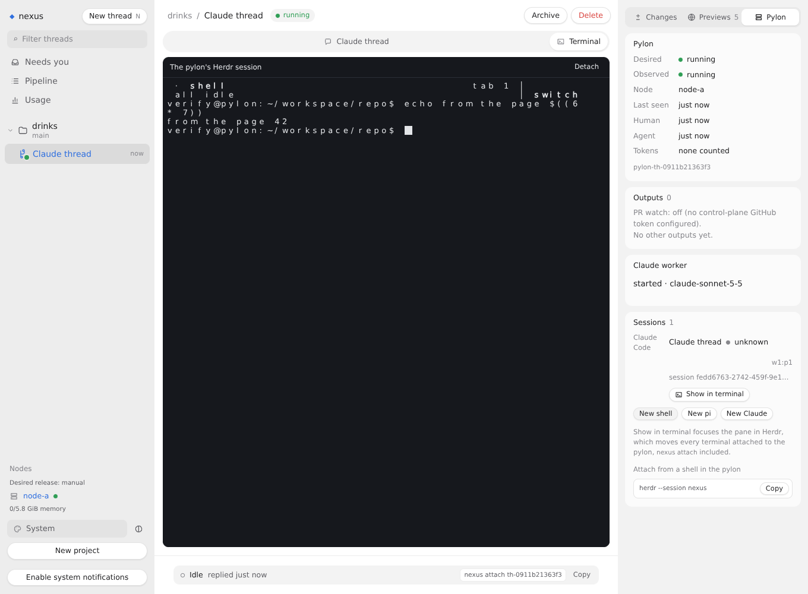
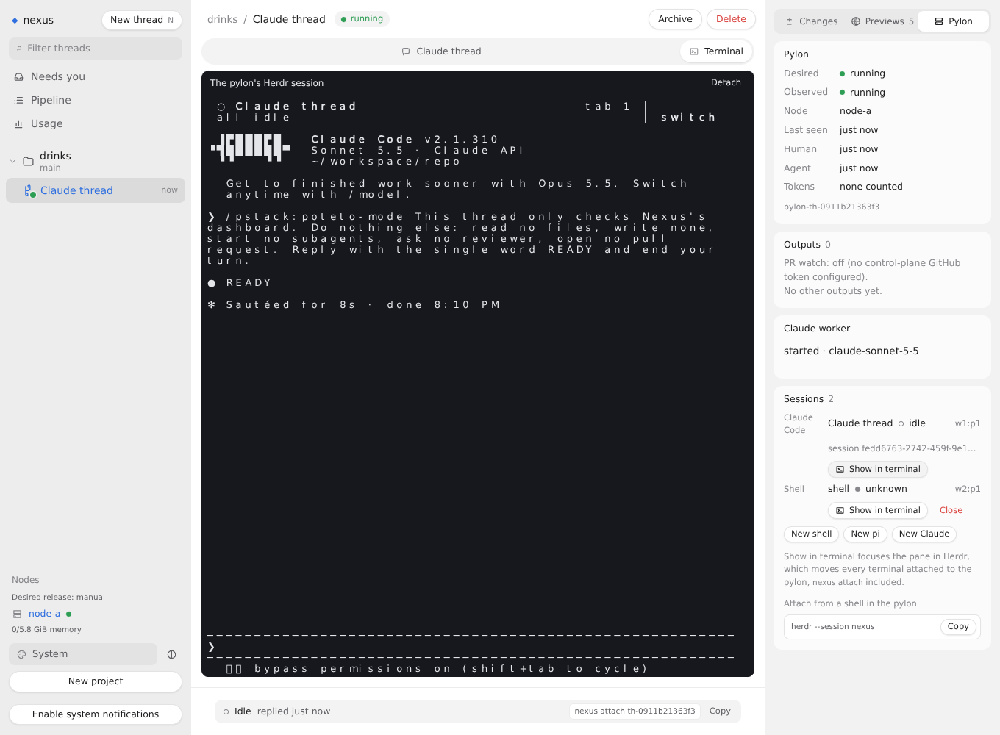
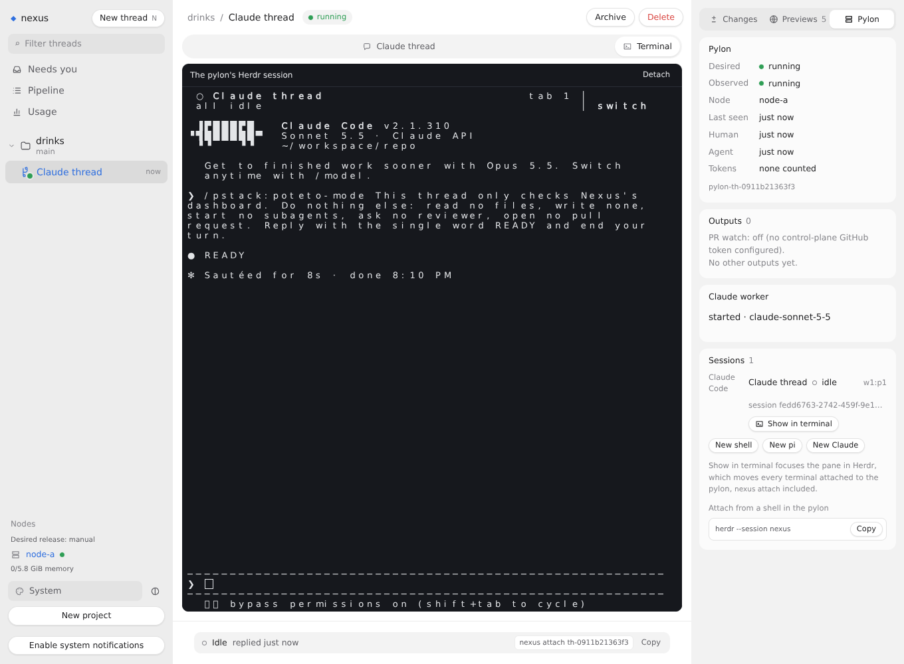

# Sessions from the thread page

Verified in this thread's pylon on 2026-10-29, on branch `feat/sessions-from-page` at `34af3f6` against main at `8fdc92b`, with Claude Code 2.1.310 on Sonnet 5.5, Herdr 0.9.5, Node 26.12.1 and headless Chromium 143 from `@sparticuz/chromium`. No live control plane, node, image or other thread was touched.

## How to rerun

```sh
MODULES=<node_modules with @sparticuz/chromium and puppeteer-core> LD_LIBRARY_PATH=<its al2023 lib> FONTCONFIG_PATH=<folder of a fonts.conf listing its fonts> \
  docs/verification/sessions-from-page/run.sh origin/main HEAD
```

`run.sh` checks out main and the branch into two worktrees, copies `stack.ts` into each, builds the dashboard and runs `stack.ts drive` there. Each run's captures land in `main/` or `branch/`, with the commit in `commit.txt`. Both runs use the same file and the same steps. `RUNS=main` or `RUNS=branch` runs one of them. It needs passwordless sudo and the Claude token placeholder in `/etc/profile.d/nexus-secrets.sh`, as a pylon has. Chromium's NSS libraries come from the package's `bin/al2023.tar.br`, unpacked by hand, since it unpacks them only on Lambda.

## The stack

Docker is not available in this pylon, so `stack.ts` is [the thread-page-interaction stack](../thread-page-interaction/README.md): the real `startControlPlane` and probe server of the checkout under test, each in a child process, and a VM backend that boots nothing, whose one pylon is this machine as the Linux user `verify`. Herdr, the Claude Code launch, the session routes, the attach route, the relay that gives the terminal a pty, and the CLI are the checkout's own code. The Claude worker is a real Claude Code. tailscaled's whois is the stand-in, and answers every caller but the probe as the person's laptop.

The driver starts a Claude worker in project `drinks`, waits for its first answer, opens the thread page at 1360 by 1000 and at a phone's 390 by 844, and picks the Pylon tab. Then, on the desktop page:

1. Presses New shell, waits for the terminal to attach, and types `echo from the page $((6 * 7))` and Enter into it.
2. Presses Show in terminal on Claude Code's session, then on the shell's.
3. Presses Detach, focuses Claude's pane with Herdr, and then presses Attach again and Show in terminal on the shell's session in the same task, so the focus is asked for while the new attach is under way.
4. Presses Close on the shell's session and OK in the confirm.

`timeline.txt` holds each step, each request the page sent, and which Herdr pane was focused. `guest.log` holds what the probe ran in the pylon, with the pane the attach landed in. `panes-*.txt` hold each pane's screen.

## Main (`main/`) and this branch (`branch/`)

| Step | main, 8fdc92b | this branch |
|---|---|---|
| The Sessions list, `01-sessions-*.png` | The sessions and the `herdr --session nexus` line. Nothing to press | New shell, New pi and New Claude, Show in terminal on Claude's session, no Close on it, and a line that says focus moves every attached terminal, `nexus attach` included |
| New shell, `02-new-shell-desktop.png` | Not possible from the page | `POST .../sessions {"harness":"shell"}`, then the terminal attached with `attach "w2:p1"` in the pylon, the shell's pane, 0.6 s after the press |
| A command in it, `03-shell-ran-desktop.png` | Not possible | The shell printed `from the page 42`, in the page's terminal and in Herdr's pane |
| Show in terminal on Claude, `04-claude-shown-desktop.png` | Not possible | `POST .../sessions/w1%3Ap1/focus`, and Herdr focused `w1:p1` 0.6 s later. The terminal showed Claude Code's `READY` |
| Show in terminal on the shell, `05-shell-shown-desktop.png` | Not possible | `POST .../sessions/w2%3Ap1/focus`, and Herdr focused `w2:p1` 0.5 s later |
| Show in terminal while an attach is under way, `06-show-while-attaching-desktop.png` | Not possible | The attach started in Claude's pane, `attach "w1:p1"`, and the page sent the focus once Herdr's client drew, within 0.1 s. Herdr focused `w2:p1`, and still did 3 s later |
| Close on the shell, `07-shell-closed-desktop.png` | Not possible | The confirm read `Close the Shell session "shell"? Its pane closes, and what runs there ends.` OK sent `DELETE .../sessions/w2%3Ap1`. Herdr closed the pane, and the list dropped it on its next poll |

Main, the Sessions list:



Branch, the shell opened from the page with the command's output:



Branch, Show in terminal on Claude Code's session:



Branch, after Close on the shell:



The fonts `@sparticuz/chromium` ships have no monospace face, and this run's `fonts.conf` was not picked up for the terminal, so xterm.js spaces its letters wide in the screenshots.

## Not checked live

- A Gondolin pylon and a real node. The pylon is this machine through sudo, so the focus ran as an `exec` here, not in a VM, and no tailnet or HTTPS listener stood between the page and the routes.
- `nexus attach` from a Mac while the page jumps. The focus is Herdr's server's, which the existing attach already relies on to land every client in Claude's pane, but no second client was attached in this run.
- New pi and New Claude from the page. They send the same request as New shell with another harness, which the unit tests cover. The `verify` user has no pi login.
- Show in terminal pressed while the terminal reattaches on its own after a dropped link. A unit test drives that through `keepAttached` with fake sockets.
- Show in terminal on a session the node has not reported yet, and a phone's taps. The phone capture only shows the list.
