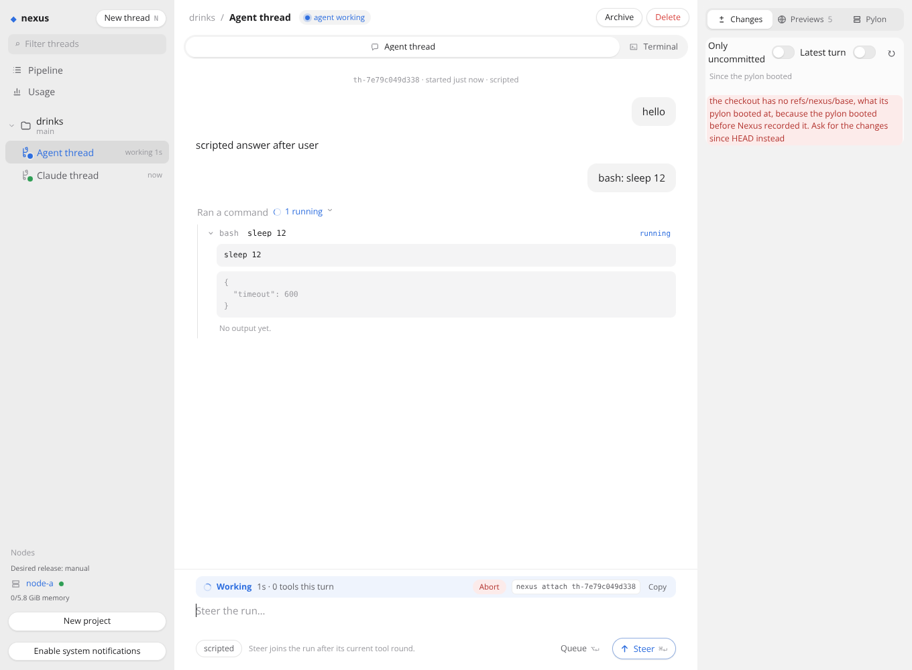
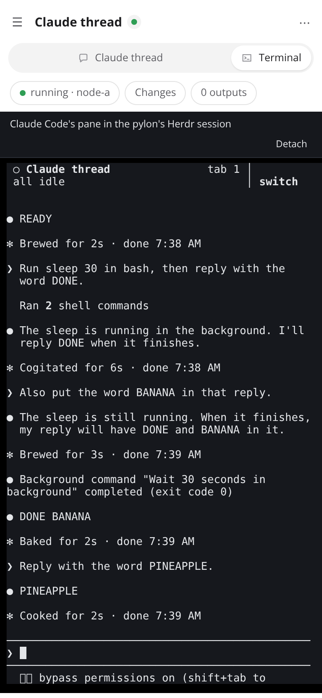

# Thread page interaction verification

Verified in this thread's pylon on 2026-10-29, on branch `feat/thread-page-interaction` against main at `0abcf9b`, with Claude Code 2.1.310 on Sonnet 5.5, Herdr 0.9.5, Node 26.12.1 and headless Chromium from `@sparticuz/chromium`. No live control plane, node, image or other thread was touched.

## How to rerun

```sh
MODULES=<node_modules with @sparticuz/chromium and puppeteer-core> LD_LIBRARY_PATH=<its al2023 lib> FONTCONFIG_PATH=<folder of a fonts.conf listing its fonts> \
  docs/verification/thread-page-interaction/run.sh origin/main HEAD
```

`run.sh` checks out main and the branch into two worktrees, copies `stack.ts` into each, builds the dashboard and runs `stack.ts drive` there. Each run's captures land in `main/` or `branch/`, with the commit in `commit.txt`. Both runs use the same file and the same steps, so the captures differ only by the code under test. `RUNS=main` or `RUNS=branch` runs one of them. It needs passwordless sudo and the Claude token placeholder in `/etc/profile.d/nexus-secrets.sh`, as a pylon has. The fonts `@sparticuz/chromium` ships have no monospace face, so this run's `fonts.conf` also named DejaVu Sans Mono from the npm package `dejavu-fonts-ttf`. Neither has a ⌘ glyph, so the shortcut hints show a box in the screenshots.

## The stack

Docker is not available in this pylon, so the verify-nexus stack could not run. `stack.ts` is [the ask-user-question-card stack](../ask-user-question-card/README.md): the real `startControlPlane` and probe server of the checkout under test, each in a child process, and a VM backend that boots nothing, whose one pylon is this machine as the Linux user `verify`. Herdr, the Claude Code launch and its hooks, the attach route, the relay that gives the terminal a pty, and the `nexus attach` and `nexus show` of the CLI are the checkout's own code. The Claude worker is a real Claude Code. The stand-ins are tailscaled's whois, which answers every caller but the probe as the person's laptop, and the Nexus agent thread's model, which is the harness's scripted one: `bash: <command>` makes one bash call in the pylon and then answers.

The driver starts a Claude worker and a Nexus agent thread in project `drinks`, then:

1. On the agent thread's page, types `hello` and presses Ctrl+Enter. Then sends `bash: sleep 12` the same way, and while it works types `steer: take this after the sleep` with Ctrl+Enter and `queued: after the run` with Alt+Enter.
2. On the Claude worker's page, sends ``Run `sleep 30` in bash, then reply with the word DONE.``, and while Claude works types `Also put the word BANANA in that reply.` with Ctrl+Enter.
3. Runs `nexus show` on both threads, opens a shell session in the Claude worker's pylon with `nexus session open --harness shell`, and focuses its Herdr workspace, as a person's last attach that switched to it would leave Herdr.
4. Runs `nexus attach` on the Claude worker in a pty, types `Reply with the word PINEAPPLE.` and Enter, and reads every Herdr pane.
5. Focuses the shell again, opens the thread page's Terminal tab at both widths, types `Reply with the word MANGO.` and Enter into it on the desktop, waits for Claude's answer, and presses Detach.

`timeline.txt` holds each step with the body each page posted to the messages route, `cli-*.txt` each CLI call, `panes-*.txt` what each Herdr pane showed and which was focused, and the screenshots are at 1360 by 1000 and at a phone's 390 by 844.

## Main (`main/`) and this branch (`branch/`)

| Step | main, 0abcf9b | this branch |
|---|---|---|
| Idle, `01-agent-idle-*.png`, `07-claude-idle-*.png` | A composer with `⌘↵ to send`. Nothing says the agent is idle, and no attach line | `Idle` above the composer, with `nexus attach <thread>` and Copy, and `Send ⌘↵` |
| A run that works, `03-agent-working-*.png`, `08-claude-working-*.png` | `The agent is working. … new messages queue`, and one button, `Queue` | `Working`, the clock and the turn's tools, Abort, the attach line, and two buttons, `Queue ⌥↵` and `Steer ⌘↵`. A Claude worker's box has only `Steer ⌘↵`, since Claude takes any message at its next step |
| Ctrl+Enter while the bash call ran | Posted with no mode, so a follow-up. `cli-05-conversation-agent.txt`: the tool's result, `scripted answer after toolResult`, and only then the message | Posted with `"mode": "steer"`. `04-agent-steered-desktop.png` shows it queued as `joins after this tool round`, and the conversation has it after the tool's result and before the run's answer |
| Alt+Enter while it ran | Nothing was posted, and the text stayed in the composer | Posted with `"mode": "followUp"`, and it got a turn of its own after the run |
| Ctrl+Enter while Claude worked | Typed into Claude, which put BANANA in its reply | The same, posted as a steer. A Claude worker types both modes into its prompt, so only the label changed |
| `nexus show`, `cli-08-show-claude.txt` | No attach line | `attach: nexus attach <thread>` under the pylon line |
| `nexus attach` with the shell focused, `panes-after-cli-attach.txt` | Landed in the shell, which ran the text: `bash: Reply: command not found` | Landed in Claude's pane, focused, and Claude answered PINEAPPLE 1.8 s later |
| The thread page's terminal, `11-terminal-*.png` | No Terminal tab. The inspector's Pylon tab shows `herdr --session nexus` to copy, which works only from a shell in the pylon | A Terminal tab beside the conversation. One click attached it in 0.7 s at both widths, in Claude's pane though the shell was focused |
| Typing into the page's terminal, `12-terminal-typed-desktop.png` | Not possible | `Reply with the word MANGO.` and Enter reached Claude, which answered 5.1 s later. Detach said `Detached. Herdr keeps its sessions running.` |

Branch, a Nexus agent run that works, at a desktop width:



Branch, the Terminal tab on a phone:



## Not verified here

- A real phone or touch keyboard. The phone captures are Chromium's mobile emulation. Typing into xterm.js with a phone's on-screen keyboard was not tried.
- A Gondolin pylon and a real node. The pylon is this machine through sudo, so the attach route's relay ran here rather than in a VM, and no tailnet, MagicDNS name or HTTPS listener stood between the page and the route. The page's WebSocket over `wss://` behind the HTTPS listener was not tried.
- The Nexus agent's steer against a real model. The scripted model has one tool round, which is enough to show where the steer joins, but not a model reading it mid-run.
- A Claude worker whose Herdr session the node has not reported yet. `nexus attach` then lands where Herdr was, as on main.
- Dark mode, and Safari or Firefox. The terminal's colors are fixed and dark in both of the page's themes.
